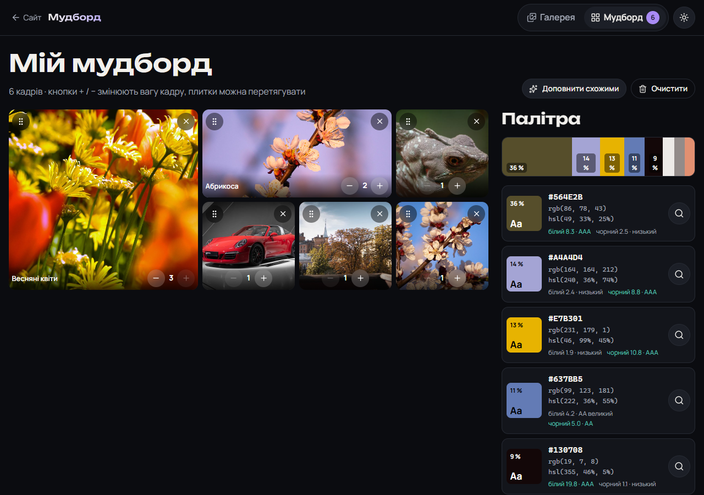

# Мудборд · Artem Arsentiev

Лабораторна робота з веб-технологій (КП № 2): реактивний інтерфейс на **Vue.js 3**.

**Тема — мудборд і палітра з моїх фото.** Замість магазину: каталог — це мої 55 фото з галереї
особистого сайту (КП № 1), а «кошик» — мудборд. Додаєте кадри, змінюєте їхню вагу (+ / −),
і застосунок сам збирає спільну палітру кольорів, підбирає схожі кадри й рахує вартість
пресетів Lightroom.

- **Сайт:** https://artem.kestrel-nrg.com/moodboard/
- **Головний сайт (КП № 1):** https://artem.kestrel-nrg.com



## Як запустити

Потрібен Node.js 20.19+ (або 22+).

```sh
cd moodboard
npm install
npm run dev       # http://localhost:5173/moodboard/
```

Інші команди:

```sh
npm run build     # збірка в теку dist/
npm run preview   # перегляд зібраної версії
npm run lint      # перевірка коду (oxlint + ESLint)
```

Проєкт створено командою `npm create vue@latest` (Vite, JavaScript, ESLint).

## Що вміє

- **Галерея:** 55 фото, фільтр за категоріями, пошук за назвою, сортування за назвою, ціною,
  світлістю, теплотою кольорів і схожістю на мудборд.
- **Кольори кожного кадру** рахуються просто в браузері (бібліотека extract-colors) і кешуються.
- **Пошук за кольором:** клік по кольору — лише кадри, де він є.
- **«Схожі»:** галерея впорядковується за схожістю палітр на обраний кадр.
- **«Зібрати мудборд»:** кадр + 5 найсхожіших одним кліком; **«Доповнити схожими»** — ще 3 до дошки.
- **Мудборд:** + / − змінюють вагу кадру (1–3), від неї — розмір плитки й частка в палітрі;
  плитки можна перетягувати.
- **Палітра:** пропорційна смуга, HEX / RGB / HSL з копіюванням, контраст тексту за WCAG.
- **Експорт:** CSS-змінні `--mood-1…` одним кліком і PNG мудборду з палітрою.
- **Пресети Lightroom:** ціна кожного кадру, знижка −20 % від 3 пресетів, форма покупки
  з перевіркою полів (демо, без оплати).
- **Анімації:** «фарбні пластинки» — кольори кадру віялом при наведенні; обраний колір піднімає
  кадри з ним, решта сіріє; фон світиться кольорами мудборду; числа перекочуються (NumberFlow);
  кадри перетікають з галереї на дошку (View Transitions API); конфеті в кольорах палітри після покупки.
- Темна / світла тема (спільна з головним сайтом), сповіщення, `prefers-reduced-motion` вимикає рух.

## Вимоги лабораторної і де вони в коді

У коментарях: **`[ЗАВДАННЯ]`** — вимога лабораторної, **`[ДОДАТКОВО]`** — власна ініціатива,
**`[1]`, `[2]`…** — рядки, що перемикають макет.

| № | Вимога | Як зроблено | Де |
|---|---|---|---|
| 1 | Каталог ≥ 8 позицій: назва, ціна, зображення, категорія; JSON через `fetch` | 55 кадрів у `public/photos.json` (назва, ціна пресета, фото 480/960, категорія), стани «завантаження» й «помилка» | `src/composables/usePhotos.js` |
| 2 | Фільтр за категорією і пошук за назвою через `computed` | `visiblePhotos` — один `computed` для категорії, пошуку, кольору й сортування | `src/components/GalleryView.vue`, `FilterBar.vue` |
| 3 | Додати, + / −, видалити; лічильник у шапці й сума оновлюються одразу | `add / increment / decrement / remove`; `count` — лічильник у шапці; підсумок — палітра (`useBoardPalette`) і сума пресетів (`PresetSummary`) | `src/composables/useBoard.js`, `AppHeader.vue`, `BoardItem.vue` |
| 4 | ≥ 2 власні компоненти, props + emit | `PhotoCard` (аналог ProductCard) і `BoardItem` (аналог CartItem), а також `FilterBar`, `ColorSwatch`, `PaletteBar`, `EmptyState`… | `src/components/` |
| 5 | Кошик у `localStorage`, `watch` | `watch(board, …, { deep: true })` зберігає мудборд, при старті читає назад | `src/composables/useBoard.js` |
| 6 | Повідомлення для порожнього кошика і «нічого не знайдено» | один компонент `EmptyState` з різним текстом і кнопками | `EmptyState.vue`, `GalleryView.vue`, `BoardView.vue` |
| 7 | Адаптивна верстка з КП № 1, без горизонтальної прокрутки | ті самі змінні, шрифти й теми; mobile-first; сітки `auto-fill + minmax(min(…, 100%), 1fr)`; container query в плитці | `src/assets/main.css`, `<style scoped>` компонентів |

**Перевірено:** горизонтальної прокрутки немає на 320, 360, 375, 768 і 1280 px; після оновлення
сторінки мудборд і вага кадрів на місці; Chrome.

## Бібліотеки

| Бібліотека | Для чого |
|---|---|
| [vue](https://vuejs.org) 3.5 | реактивність, компоненти |
| [extract-colors](https://github.com/Namide/extract-colors) | основні кольори фото через `<canvas>` |
| [culori](https://culorijs.org) | колірний простір OKLab, відстань між кольорами, контраст WCAG |
| [@vueuse/core](https://vueuse.org) | тема (`useColorMode`), копіювання (`useClipboard`) |
| [vue-draggable-plus](https://vue-draggable-plus.pages.dev) | перетягування плиток (SortableJS) |
| [html-to-image](https://github.com/bubkoo/html-to-image) | PNG мудборду |
| [vee-validate](https://vee-validate.logaretm.com) + [zod](https://zod.dev) | перевірка полів форми покупки |
| [vue-sonner](https://vue-sonner.vercel.app) | спливні сповіщення |
| [@lucide/vue](https://lucide.dev) | іконки |
| [@number-flow/vue](https://number-flow.barvian.me) | числа, що перекочуються |
| [canvas-confetti](https://github.com/catdad/canvas-confetti) | конфеті після покупки |

## Структура

```
public/photos.json        — каталог: категорії і 55 кадрів
public/img/               — фото 480 і 960 px
src/App.vue               — шапка, перемикання «Галерея / Мудборд», сповіщення
src/composables/          — стан і логіка:
  usePhotos.js            —   fetch каталогу
  useBoard.js             —   мудборд («кошик») + localStorage через watch
  usePalettes.js          —   кольори кадрів (extract-colors) + кеш
  useBoardPalette.js      —   спільна палітра мудборду (computed)
  useSimilar.js           —   схожі кадри
  useFilters.js           —   стан фільтрів галереї
src/utils/color.js        — злиття палітр, схожість, світлість, контраст (culori)
src/components/           — PhotoCard, BoardItem, FilterBar, PaletteBar, PaletteDetails,
                            ExportPanel, PresetSummary, PurchaseDialog, EmptyState…
```

## Розгортання

Мудборд — тека `moodboard/` у репозиторії особистого сайту. GitHub Actions
(`.github/workflows/deploy.yml` у корені репозиторію) на кожен push у `main` збирає його
й разом зі сторінками КП № 1 кладе готовий сайт у гілку `deploy`. Сервер (Caddy) раз на хвилину
підтягує цю гілку; мудборд відкривається за адресою `/moodboard/`.

Фото — власні, з галереї головного сайту.
